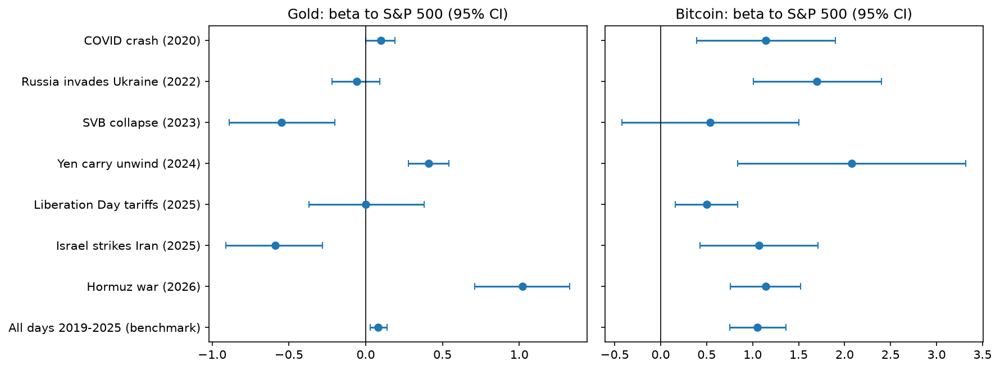
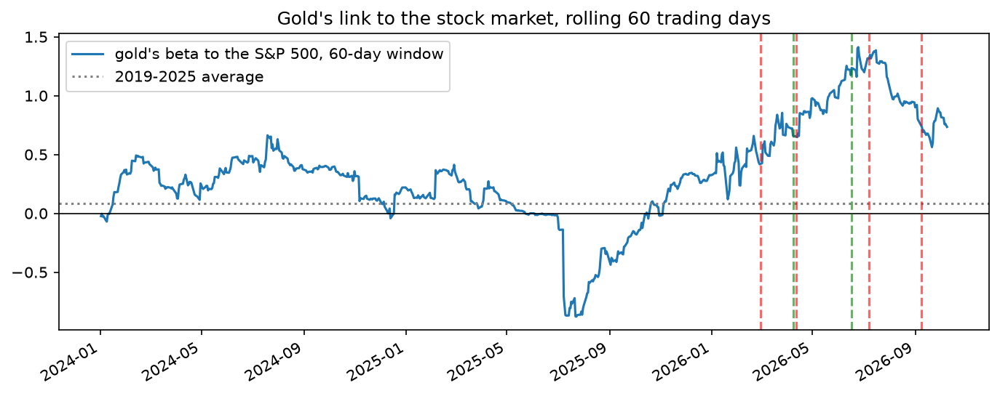

# Is Bitcoin a Safe Haven? Evidence from the 2026 Strait of Hormuz Crisis

When a war or crisis hits, investors look for assets that protect them from falling stocks. Research separates two kinds of protection: a **hedge** does not move with stocks on average, and a **safe haven** holds its value on the days when stocks fall sharply. Gold is the classic example of both, and some people argue that Bitcoin is "digital gold". This project uses the 2026 Strait of Hormuz crisis, when fighting around one of the world's most important oil routes sent oil prices sharply higher, to test whether either of them actually behaved this way.

**Full analysis:** [analysis.ipynb](analysis.ipynb) (Python)



*Each dot shows how closely an asset followed the US stock market during a market shock (0 means no connection; 1 means it moved as much as stocks, in the same direction). Lines show the range of uncertainty. Gold usually sits near or below zero; in 2026 it jumped to about 1.*

## In short

Bitcoin behaved like a risky investment rather than a safe haven, as it has since 2019. Gold, unusually, rose and fell with the stock market during the 2026 conflict, but there were too few sharp market falls to tell whether it still protects investors in a crash. These are patterns in prices; on their own they cannot show that the war caused them.

## Key findings

**Gold followed the stock market far more than usual.** Over 2019–2025 as a whole, gold's daily moves had little to do with stocks; during the conflict, the two often rose and fell together, with gold moving about as much as stocks. Compared over the same length of time, no other market shock since 2019 comes close, including a similar Israel–Iran conflict in June 2025, and the result is not driven by a handful of big market days.

**But the change began before the war, and its size depends on the comparison.** Gold moved against stocks in the summer of 2025, and its link to stocks began rising around November 2025, about four months before the war, before peaking during the conflict. Measured against the winter months just before the war, the increase is roughly half as large as against June 2025 – January 2026. Against four different "before" periods it is always there, but clearly larger than chance for only two of them: the main period and the 180 days before the war.

**The result holds with a direct measure of interest rates.** One possible reason for the change is that gold and stocks were both reacting to the same news about interest rates. Replacing the bond fund with the 10-year inflation-adjusted interest rate barely changes the result. Gold did become more sensitive to interest rates during the conflict, but allowing for this leaves its closer link with stocks in place. This cannot rule out every role for interest rates.

**On the two sharp market falls during the conflict, gold fell too,** and by more than stocks. On similar days in 2019–2025 it was roughly flat on average.

**For Bitcoin, the main evidence is its long-run behaviour.** Since 2019 it has tended to move about as much as US stocks, and even more than stocks on their very worst days. In 2026 it still moved about as much as stocks or more, whether its price is taken at the US market close or later in the evening. On individual conflict days, it rose about 6% more than expected in the two days after the war began, but that is not clearly unusual once the number of comparisons is taken into account, and an apparent fall after the ceasefire disappears when its price is taken at the US close.

**Bitcoin and gold moved more closely together during the conflict.** Their shared link to stocks explains part of this, but not all.



*Gold's link to the US stock market, measured over moving 60-trading-day windows (0 means no connection; 1 means it moved as much as stocks). Dashed lines mark the six 2026 events (red for escalation, green for de-escalation). The link began rising in late 2025 and peaked during the conflict.*

## What this means

Whether an asset behaves as a hedge is not a fixed fact; it can change from one crisis to the next, so investors should not assume gold will always move independently of stocks. I could not establish why 2026 was different; a shared reaction to news about long-term interest rates does not appear to be the main reason, although this check cannot rule it out. One possibility, which I did not test, is that some investors sold gold to lock in profits after its sharp rise in 2025.

## How I did it

1. **Worst days for stocks, 2019–2025 (main evidence for Bitcoin).** A standard test from academic research (Baur and Lucey, 2010) checks how closely an asset follows stocks on normal days and on the very worst days for the stock market.
2. **Before vs. during the conflict (main evidence for gold).** I compared how closely Bitcoin and gold followed stocks, oil, the US dollar and interest rates before and during the conflict, using four different "before" periods, and repeated the main test with a direct measure of inflation-adjusted interest rates.
3. **2026 vs. earlier shocks.** I repeated the comparison for six earlier market shocks since 2019, including the COVID crash, Russia's invasion of Ukraine and the 2025 US tariff announcements, over each shock's full length and over its first 40 trading days. A month-by-month view shows when gold's link to stocks began to rise, and a check without the biggest market days shows whether a few days drive the result.
4. **Key conflict days (supporting evidence).** For six key moments in 2026, I looked at how Bitcoin and gold moved over the next one to three trading days, after taking out the part explained by the stock market, and compared those moves with their normal range. Because Bitcoin trades around the clock, I repeated the timing-sensitive tests with its price at the 4 p.m. US close.

## How confident am I?

- The 2026 conflict produced only six clear events and two sharp stock-market falls to study.
- Some results depend on which "before" period is used, and the main one is itself mixed, so I report several and also compare with 2019–2025.
- Bitcoin's main daily price is recorded in the evening, after the US close. Repeating the timing-sensitive tests with its 4 p.m. price changes two Bitcoin results, as described above.
- Event dates come from news timelines, and I did not check for other economic news released on the same days.
- I use funds that track stocks, gold and oil as stand-ins for the assets themselves.

## Key numbers

**Beta** measures how much an asset moves when the S&P 500 moves by 1% (0 = no relation, 1 = one-for-one); CI is a 95% confidence interval. The full table and model definitions are in the Technical notes at the end of the notebook.

| Measure | Result |
|---|---|
| Bitcoin's beta to the S&P 500, 2019–2025: normal days vs. worst 1% of days (Baur–Lucey test) | 0.84 vs. 1.58 |
| Bitcoin's beta, 2026 conflict period (midnight UTC / 4 p.m. ET price) | 1.14 (95% CI 0.76 to 1.52) / 1.37 |
| Gold's beta to the S&P 500, all days 2019–2025 | 0.08 (95% CI 0.03 to 0.14) |
| Gold's beta, 2026 conflict period (Mar 2 – Oct 9) | 1.02 (95% CI 0.71 to 1.33) |
| Change in gold's beta, conflict vs. Jun 2025 – Jan 2026 (S&P 500, oil, dollar and TIPS all allowed to change) | +0.74 (95% CI 0.17 to 1.30) |
| Same change against the last 60 / 120 / 180 pre-war trading days | +0.55 / +0.48 / +0.66 (p = 0.25 / 0.15 / 0.03) |
| Same change with the 10-year real interest rate in place of TIPS | +0.76 (95% CI 0.19 to 1.33) |
| 2026 days with the S&P 500 in its 2019–2025 worst 5% | 2 days; gold fell on both (average −3.7%, S&P 500 −2.2%) |
| Bitcoin–gold correlation, before vs. conflict | 0.10 vs. 0.43 (0.29 after removing stock-market moves) |

- **Event study:** oil moved +10.2% in the two days after the war began and −10.0% after the ceasefire, confirming that the event dates capture real shocks. After adjusting for the number of comparisons, no event-day move by Bitcoin or gold stands out.
- **Correlations** are supporting evidence only, because they rise mechanically with volatility (Forbes and Rigobon, 2002).

## Data

- **Massive API** (formerly Polygon.io): daily prices for Bitcoin (X:BTCUSD), the S&P 500 (SPY), gold (GLD and spot XAU/USD), Brent oil (BNO), the US dollar (UUP) and TIPS (TIP), plus hourly Bitcoin prices for the US-close check.
- **FRED** (Federal Reserve Bank of St. Louis): the daily 10-year inflation-adjusted Treasury yield (series DFII10), downloaded directly; no key needed.
- **Yahoo Finance** (via `yfinance`): Bitcoin prices before October 2024, used for the 2019–2026 historical comparison. Over the 495 days covered by both sources, their daily returns have a correlation of 0.9995.
- **Event dates** come from news timelines of the 2026 conflict; the notebook lists each date, the first US trading day used and the source.
- Raw price data are not included in this repository because of the data provider's license terms.

## How to run

1. Install the packages:
   ```
   pip install massive pandas numpy matplotlib statsmodels scipy yfinance jupyter
   ```
2. Open `analysis.ipynb` in Jupyter and run all cells. You will be asked for your own Massive API key; it is not stored in the notebook.

## References

- Baur, D. G., & Lucey, B. M. (2010). Is gold a hedge or a safe haven? An analysis of stocks, bonds and gold. *Financial Review*, 45(2), 217–229.
- Baur, D. G., & Smales, L. A. (2020). Hedging geopolitical risk with precious metals. *Journal of Banking & Finance*, 117, 105823.
- Bouri, E., Molnár, P., Azzi, G., Roubaud, D., & Hagfors, L. I. (2017). On the hedge and safe haven properties of Bitcoin: Is it really more than a diversifier? *Finance Research Letters*, 20, 192–198.
- Conlon, T., & McGee, R. (2020). Safe haven or risky hazard? Bitcoin during the Covid-19 bear market. *Finance Research Letters*, 35, 101607.
- Forbes, K. J., & Rigobon, R. (2002). No contagion, only interdependence: Measuring stock market comovements. *Journal of Finance*, 57(5), 2223–2261.
- Klein, T., Pham Thu, H., & Walther, T. (2018). Bitcoin is not the New Gold – A comparison of volatility, correlation, and portfolio performance. *International Review of Financial Analysis*, 59, 105–116.
- MacKinlay, A. C. (1997). Event studies in economics and finance. *Journal of Economic Literature*, 35(1), 13–39.
- Newey, W. K., & West, K. D. (1987). A simple, positive semi-definite, heteroskedasticity and autocorrelation consistent covariance matrix. *Econometrica*, 55(3), 703–708.

## Author

Xiang Zheng, University of Toronto (Economics major; Statistics and Mathematics minors)
